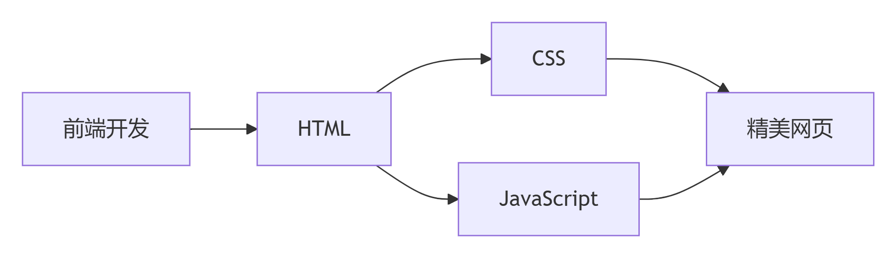
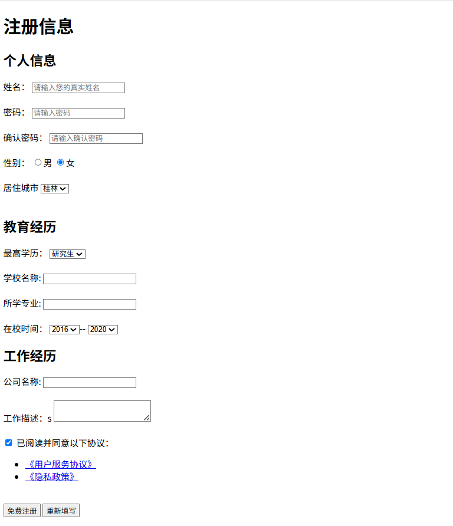
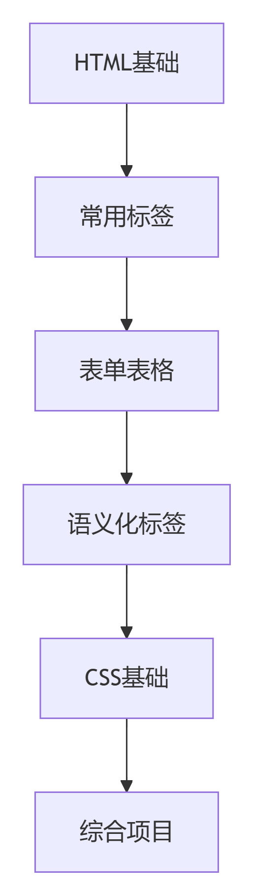

# <span style="color:pink; font-family:Arial;text-align:center">🌟HTML基础语法速通指南</span>


## 📖 第一章：HTML是什么？

### 什么是HTML？
   HTML（HyperText Markup Language，超文本标记语言）是构建所有网页的基础骨架。它通过一系列“标签”来描述网页的结构和内容。
   **核心理解：**
   - 🔧 标记语言：不是编程语言，而是用来“标记”内容的语言
   - 🏗️ 网页骨架：定义网页的结构框架
   - 📝 内容组织：告诉浏览器如何显示文本、图片等内容
### 为什么要学习HTML？
  在我们了解了HTML是什么之后，我们要清楚学习HTML有什么用，才能更明白我们是为什么而学习HTML.
  
  **HTML的核心价值：**
- 🌐 所有网页的基础：没有HTML就没有网页
- 🚀 前端开发的起点：学习前端的第一步
- 🔗 内容与样式的桥梁：连接内容和视觉呈现
- 💡 简单易学：标签式语法，上手快速


## 📝第二章：HTML文档结构


### 基本HTML文档结构
```html
<!DOCTYPE html>
<html>
<head>
    <title>页面标题</title>
</head>
<body>
    <h1>我的第一个标题</h1>
    <p>我的第一个段落。</p>
</body>
</html>
```
**主要组成部分详解**
```html
1. <!DOCTYPE html>
文档类型声明
告诉浏览器这是 HTML5 文档

2. <html>
HTML 文档的根元素
包含整个网页内容

3. <head>
包含元数据（不会显示在页面中）
包含标题、字符集、样式表链接等

4. <body>
包含所有可见的网页内容
文本、图片、链接等都放在这里
```


## 🏷️ 第三章：HTML标签详解


### 标签的基本概念
**标签类型：**
HTML是标签语言，标签就是<>，标签分为单标签和双标签。单标签的引用如< br >是换行标签，输入的文本想要换行就用< br>单标签即可。双标签的引用如：< div>  内容  < /div>.这就是HTML的单双标签运用啦。
```html
<!-- 双标签（有开始和结束） -->
<标签名>内容</标签名>

<!-- 单标签（自闭合） -->
<标签名> 或 <标签名/>

```


### 文本格式化标签
```html
<!-- 标题标签（h1-h6） -->
<h1>一级标题</h1>
<h2>二级标题</h2>
<h3>三级标题</h3>

<!-- 段落和换行 -->
<p>这是一个段落。</p>
<br>  <!-- 换行（单标签） -->
<hr>  <!-- 水平线（单标签） -->

<!-- 文本样式 -->
<strong>加粗（语义化）</strong>
<b>加粗（仅样式）</b>
<em>强调（斜体）</em>
<i>斜体（仅样式）</i>
<u>下划线</u>
<s>删除线</s>
```
以上便是文本标签的介绍啦，要注意的是，br和hr是单标签，其他都是双标签。


### 链接与图片
```html
<!-- 超链接 -->
<a href="https://www.example.com" target="_blank">点击访问</a>
<!-- 图片 -->

```
- href：链接地址
- target="_blank"：新窗口打开
- src：图片路径
- alt：替代文本（图片无法显示时显示）
<br>
首先，来解释一下什么是超链接？超链接是可点击的文字或图片，点击后跳转到其他网页或位置。img标签就很好解释了，可以把你想要展示的图片给展示出来。


### 列表标签
列表有三种，无序列表，有序列表，定义列表，它们各自的用法如下：
```html
 <!-- 无序列表 -->
<ul>          
    <li>项目1</li>
    <li>项目2</li>
    <li>项目3</li>
</ul>   

<!-- 有序列表 -->
<ol>           
    <li>第一项</li>
    <li>第二项</li>
    <li>第三项</li>
</ol>

 <!-- 定义列表 -->
  <dl>
   <dt>HTML</dt>
       <dd>超文本标记语言</dd>

    <dt>CSS</dt>
       <dd>层叠样式表</dd>
  <dl>
```
这里不展示列表的效果了，感兴趣的可以[点击此处跳转](https://www.bilibili.com/video/BV1kM4y127Li)观看列表运用的效果。


### 表格标签
可以通过以下标签语言实现表格在网页的生成
```html
<table border="1">
    <caption>学生成绩表</caption>
    <tr>
        <th>姓名</th>
        <th>语文</th>
        <th>数学</th>
        <th>英语</th>
    </tr>
    <tr>
        <td>张三</td>
        <td>90</td>
        <td>95</td>
        <td>88</td>
    </tr>
</table>
```
同上，这里不展示列表的效果了，感兴趣的可以[点击此处跳转](https://www.bilibili.com/video/BV1kM4y127Li)观看列表运用的效果。


## 第四章：表单实战示例
关于表单就比较有趣了，如下我给出关于表单综合运用的html代码，大家也可以复制在vscode中运行，就可以看到它的效果了。我也会给出这一串代码的显示效果图，感受以下表单的神妙吧！
```html
<!DOCTYPE html>
<html lang="en">
<head>
    <meta charset="UTF-8">
    <meta name="viewport" content="width=device-width, initial-scale=1.0">
    <title>📝注册信息</title>
</head>
<body>
    <h1>注册信息</h1>
    <!-- 表单控件 -->
    <form action="">

    <!-- 个人信息 -->
        <h2>👤个人信息</h2>
        <label >姓名：</label>
        <input type="text" placeholder="请输入您的真实姓名">
        <br><br>

        <label>密码：</label>
        <input type="password" placeholder="请输入密码">
        <br><br>

        <label >确认密码：</label>
        <input type="password" placeholder="请输入确认密码">
        <br><br>

        <label>性别：</label>
        <label><input type="radio" name="gender">男</label>
        <label><input type="radio" name="gender" checked>女</label>
        <br><br>

        <label>居住城市</label>
        <select>
            <option>北京</option>
            <option>上海</option>
            <option>广州</option>
            <option>深圳</option>
            <option selected>桂林</option>
        </select>
        <br><br>

        <!-- 教育经历 -->
        <h2>🎓 教育经历</h2>

        <label>最高学历：</label>
        <select>
            <option>研究生</option>
            <option>本科生</option>
            <option>高中</option>
            <option>初中</option>
            <option>小学</option>
        </select>
        <br><br>

        <label>学校名称:</label>
        <input type="text">
        <br><br>

        <label>所学专业:</label>
        <input type="text">
        <br><br>

        <label>在校时间：</label>
        <select>
            <option>2016</option>
            <option>2017</option>
            <option>2018</option>
            <option>2019</option>
            <option>2020</option>
            <option>2021</option>
        </select>--
        <select>
            <option>2020</option>
            <option>2021</option>
            <option>2022</option>
            <option>2023</option>
            <option>2024</option>
            <option>2025</option>
        </select>
        <br>

        <!-- 工作经历 -->
         <h2>💼工作经历</h2>

         <label>公司名称:</label>
         <input type="text">
         <br><br>

         <label>工作描述：</label>
         <textarea></textarea>
         <br><br>

        <!-- 协议和按钮 -->
         <input type="checkbox" checked>
         <label>已阅读并同意以下协议：</label>
         <br>

         <ul>
            <li><a href="#">《用户服务协议》</a></li>
            <li><a href="#">《隐私政策》</a></li>
         </ul>
         <br>

         <button type="button">免费注册</button>
         <button type="reset">重新填写</button>
    </form>
</body>
</html>

```
**代码运行后的效果如下**

有没有感觉到一丝丝的熟悉感呢？这就是我们注册个人账号经常能看到页面运用到的HTML，待学习CSS之后，对这些内容包装美化之后，我们也就能够做出我们平时看到的登录界面了！


##  🎯 第五章：学习建议与资源


### 学习路径建议


### 推荐学习资源 
- 视频教程：[@B站黑马HTML入门教程](https://www.bilibili.com/video/BV1kM4y127Li/?vd_source)
- 在线练习：[@W3Schools HTML教程](https://www.w3schools.com/html/)
- 文档参考：[@MDN Web文档](https://developer.mozilla.org/zh-CN/docs/Web/HTML)

### 最佳实践
**1.语义化标签：**优先使用有意义的标签
**2.属性引号：**始终使用双引号包裹属性值
**3.代码缩进：**保持一致的缩进风格
**4.注释说明：**复杂代码添加注释
**5.标签闭合：**确保所有标签正确闭合


## 📌 第六章：常见问题

### Q1：HTML难学吗？
**A：**HTML是所有前端技术中最简单的一环，只需要记忆常用标签和属性，没有复杂的逻辑。

### Q2：需要记住所有标签吗？
**A：**不需要！记住最常用的20-30个标签即可，其他用到时查阅文档。

### Q3：如何快速掌握？
**A：**边学边练！在VS Code中创建.html文件，实时查看效果。


## ✨ 总结
HTML作为前端开发的基石，具有以下特点：
- ✅ 入门简单：标签式语法直观易懂
- ✅ 实用性强：学完就能创建简单网页
- ✅ 承上启下：为学习CSS和JavaScript打下基础
- ✅ 就业必备：所有前端岗位的基础要求

**学习箴言：**
HTML就像建房子的砖块，掌握它，你就拥有了构建数字世界的基本能力。
现在就开始动手写你的第一个HTML页面吧！

资源汇总：
[@🔗HTML5新特性详解](https://developer.mozilla.org/zh-CN/docs/Web/Guide/HTML/HTML5)
[@🔗HTML语义化指南](https://www.w3schools.com/html/html5_semantic_elements.asp)
[@🔗响应式HTML基础 ](https://css-tricks.com/snippets/html/responsive-meta-tag/)


本文作为HTML入门指南，后续将推出CSS和JavaScript系列教程。
