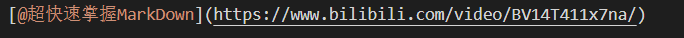

# MarkDown入门使用教程
## 为什么要使用MarkDown？
###  什么是MarkDown?
Markdown 是一种轻量级的标记语言，它允许人们使用易读易写的纯文本格式编写文档，然后转换成有效的 HTML 文档。（HTML是轻文本标记语言，是前端三剑客之一）
###  为什么要使用MarkDown？
使用 Markdown 的核心原因是：**它让你专注于内容创作，而不是格式调整。** 下面从几个角度说明
  1. 极简高效。例如：一级标题用#，二级标题##，以此类推到六级标题。
  2. 一次编写，多处发布。同一份文档可以：
    ✓ 发布到博客（这是小🐟用MarkDown的主要原因）
    ✓ 生成 PDF
    ✓ 转换为 Word
    ✓ 展示在网页
    ✓ 在 GitHub 显示
    无需重复排版，自动适应不同平台。
## MarkDown的基础使用
### 标题  
标题不用像在word那样手动调标题级别了，在书写文本时，一个符号“#”代表一级标题，"######"则代表六级标题  
### 段落和换行
普通段落：直接输入文本
### 文字样式
- 在想要斜体的文字两边各加一个符号"*"即可，如：*我是斜体*
- 在想要加粗效果的文字，在文字两边各加上"**"即可，
如 **我是加粗**
- 既要又要，在文字两边各加上文字两边各加上"***"即可 ，
  如 ***我是斜体加粗***
- 要注意的是，**这些符号的使用要有一个空格**
### 列表
   1. 无序列表：在每一段文字面前加上"-（* +）"任意一个都即可，无序列表的显示效果在3.文字样式有体现。
   2. 有序列表： 就直接"1. 2. 3."的就可以了（数字加点之后需要空一个格）。有序列表可以嵌套。
   3. 任务列表：在每一段文字面前加上"-[ ]"即可，如下是任务列表的显示效果：
- [] **任务列表的显示效果**
- [x] MarkDown使用教程博客分享
- [ ] 完成CSS的学习
- [x] 睡觉
- [x] 吃饭
**以上便是列表的简单介绍啦**
### 表格

| 姓名  | 年龄  | 兴趣爱好 |
| :---: | :---: | :------: |
| 张三  |  2.5  |   唱歌   |
| 李四  |  25   |   跳舞   |
| 王五  |  2.5  |  打篮球  |

### 水平分割线
用---，***, ___即可
显示效果如下：

---
***
___
### 超链接
首先，什么是超链接呢？超链接的本质就是“一键传送门”，我们通常可以通过点击一个链接跳转至其他页面，这个就是超链接的运用。在结语第三点我使用超链接给读者们分享了一个我认为能够“超快速掌握MarkDown”的视频。
其次在MarkDown中使用超链接的语法是：[@自定义内容]（想要跳转的网页地址）
如图：

## 结语
1. MarkDown的使用还是有挺多的，字体格式、字体颜色等等，本文章不再一一介绍
感兴趣的读者可以自行找相关资源去学习使用。
2. 本博客的书写主要是小🐟学习了MarkDown的使用之后，练习写下的博客。如有表达不清之处，望大佬们海涵。
3. 想要超快速学习使用MarkDown的可跳转此视频：[@超快速掌握MarkDown](https://www.bilibili.com/video/BV14T411x7na/)