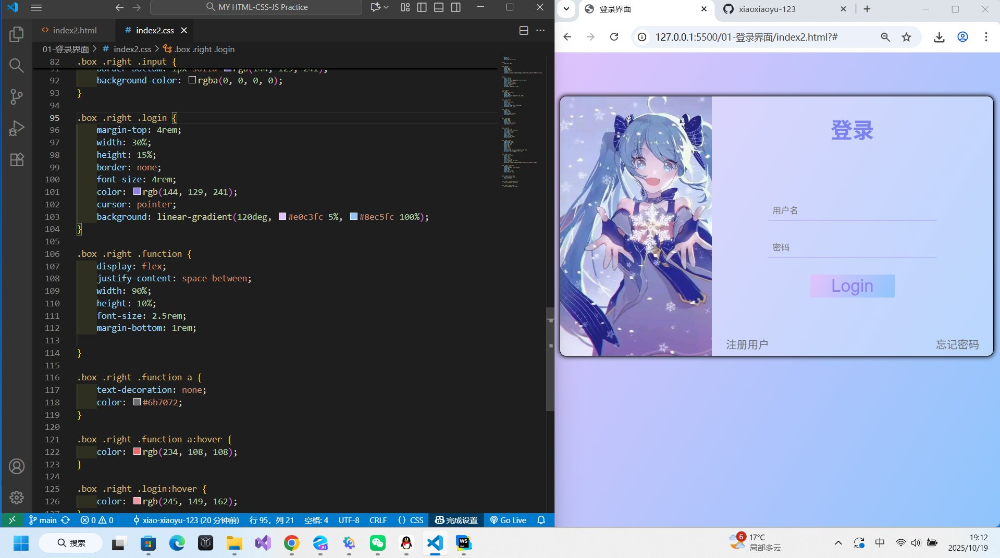
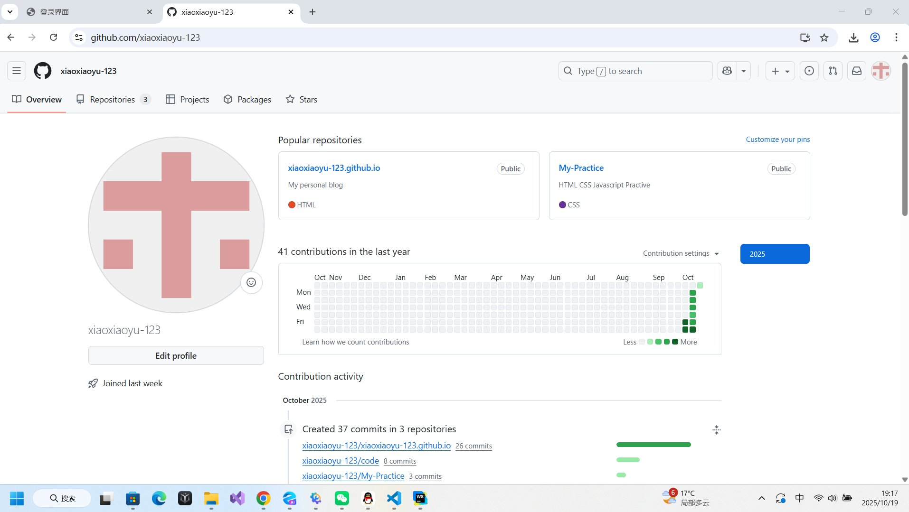

# 每周总结第一期（10.13-10.19）

## 核心成果

### CSS的学习进展
1. 基础掌握：已完成CSS核心概念学习
2. 实践成果：能够独立实现美观的登录界面，
   登录界面预览：
3.**界面特点总结：**
- [x] 视觉效果：渐变背景 + 毛玻璃效果
- [x] 布局专业：合理分区与间距控制
- [x] 交互友好：完整的悬停反馈状态
- [x] 代码规范：清晰的HTML结构 + 语义化CSS命名
- [x] 响应式基础：采用相对单位 + Flex布局
- [x] 设计现代：符合当前UI设计趋势
 

### Git & GitHub 掌握情况
1. 🔧 日常开发三板斧（已熟练）
   - git add .   ——表示添加本地此根目录下所有文件（简单理解为添加修改和增加的东西就好）
   - git commit -m "测试提交"   ——提交添加和增加的东西
   - git push origin main   ——推送提交的东西到GitHub上
   - 经过这三个操作指令便可以把你本地修改和增加的代码等，部署到你已经在GitHub上建立好的仓库。  
<!--   -->
1. 掌握了在VSCode中通过终端将新代码部署到新的GitHub仓库
    - 登录GitHub，点击“New repository”创建新的仓库。
    - git init 初始化本地仓库
    - git add . 添加所有文件到暂缓区
    - git commit -m "initial commit" 提交更改
    - git remote add origin https://github.com/你的用户名/你的仓库名.git 添加远程仓库地址
    - git push -u origin main 推送代码到GitHub，-u是首次推送的参数
    - 经过以上操作，就能够在VScode中通过终端将新代码部署到新的GitHub仓库啦！
2. 在VSCode中通过终端将新代码部署到新的GitHub仓库可能遇到的问题
   - 出现错误说main分支不存在，按以下操作尝试找出问题并解决
   - git branch 检查当前分支
   - 如果显示分支是master，而不是main,使用：git push -u origin master
   - 也可以通过重命名分支在指令：git branch -M main ，再推送：git push origin main 
3. 以下是我GitHub仓库使用频率的主页
   
 

## 🧩遇到的问题与解决方案
**核心心得**：遇到问题不要慌，合理利用工具和资源
### 解决路径
   1.首选AI助手（如DeepSeek）
   - 详细描述问题背景
   - 附上相关代码或截图
   - 开启“深度思考”模式获取更优解
  
  2.寻求人工帮助
   - 咨询学长学姐
   - 技术社区提问（如Stack Overflow）

### 个人体会
   大部分问题都能通过AI得到有效解决，再次证明**合理利用AI是高效学习的关键。**

## 下周计划
### JavaScript学习
   - 掌握基础语法（变量、函数、循环等）

   - 完成基础练习项目

### HTML & CSS效果练习
-  轮播图
-  视差滚动
-  多级菜单设计
-  时间轴
-  导航栏
-  旋转音乐播放器
-  手风琴
-  下拉菜单
-  杂志切换效果
-  滑动名片

