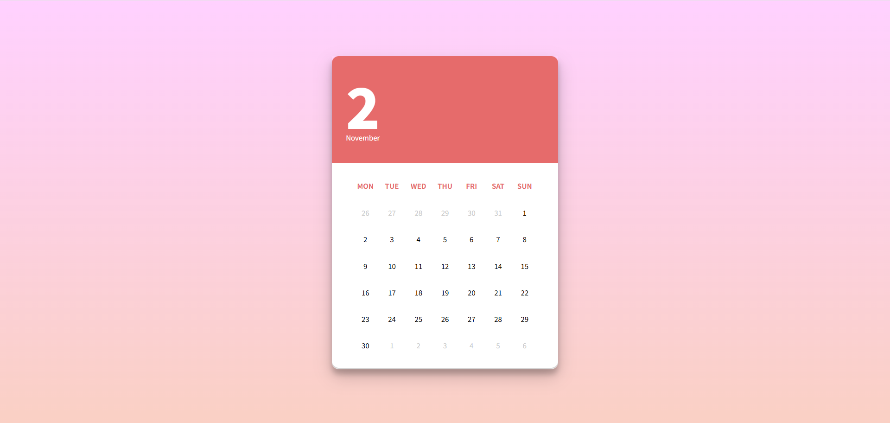

# 每周总结第三期（10.27-11.2）
## 一些碎碎念
时间总是过得飞快，转眼又是一周。这周主要在专业课和前端学习之间切换，有些疲惫，也有些收获。

## 前端学习：在模仿中进步
最近我沉迷于. CSS 实现各种动态和交互效果，感觉这部分真的挺考验功底。我的学习方式是：
1.先跟着教程或视频“抄”一遍

2.再尝试自己从头实现

3.遇到卡住的地方，回头再看思路

虽然过程常常卡壳，但每次最终实现效果时，那种成就感真的很棒！

目前的状态：
✅ HTML / CSS 算是入门了，但能独立实现的效果还不多

✅ JavaScript 基础语法刚学完，还没能灵活结合 CSS 做出更丰富的交互

## 专业课：抽象代数好难！
不得不说，抽象代数真的太折磨人了……全是证明题，看得我头大。为了弄懂一类题型，我花了近三个小时翻视频、查资料，才勉强搞明白。果然，是我太菜了吗 😭

## 其他杂事
脑抽报名了 CMC，现在复习时间严重不足，打算主攻解析几何

课表排得满满当当，根本喘不过气……

## ✅ 本周核心成果
###   JavaScript的学习
- [x]  掌握基础语法（变量、函数、循环等）
### 关于HTML和CSS的实现的效果练习
- [x] 轮播图
- [x] 视差滚动
- [ ] 多级菜单设计
- [ ] 时间轴
- [x] 导航栏
- [x] 旋转音乐播放器
- [x] 手风琴
- [x] 下拉菜单
- [x] 杂志切换效果
- [ ] 滑动名片
- [x] 日历
下面随机展示一些实现的效果图吧：

## 📅下周计划
**全力准备 CMC，前端学习暂缓。**