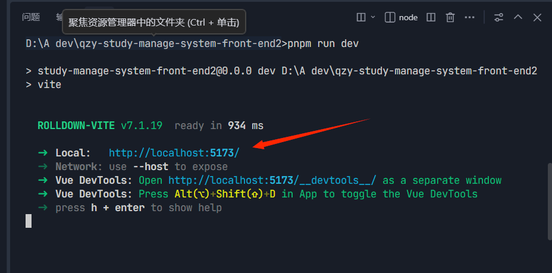
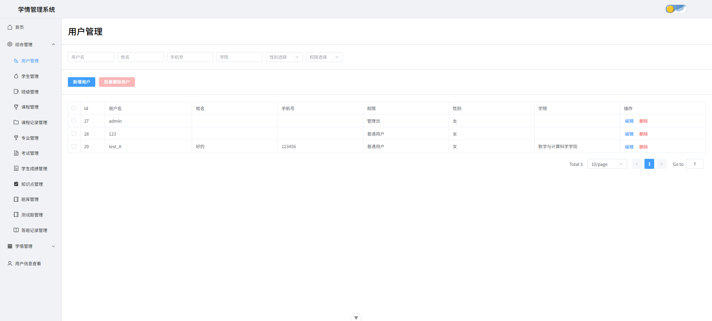
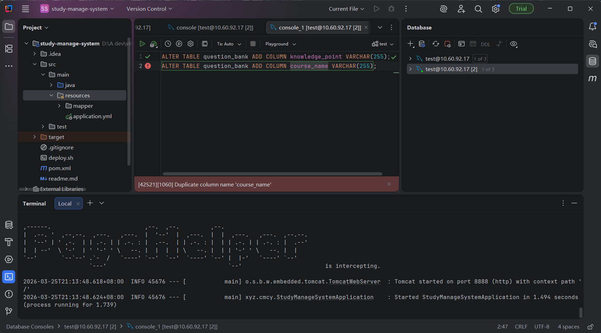

# 项目前后端成功部署与运行的过程

## 前言

本文将详细介绍项目前后端从环境配置到成功运行的完整流程，包括前端和后端的具体部署步骤，帮助开发者快速上手项目运行。

## 前端部署与运行

### 环境配置

1. **安装 Node.js**
   - 访问 [Node.js 官方网站](https://nodejs.org/zh-cn/download) 下载并安装适合你操作系统的版本

2. **安装 Trae 开发工具**
   - 访问 [Trae 官方网站](https://www.trae.cn/) 下载并安装

### 安装项目依赖

1. 打开 Trae 开发工具，导入前端项目
2. 打开终端（快捷键：Ctrl + `），执行以下命令：

   ```bash
   # 全局安装 pnpm 包管理器
   npm install -g pnpm
   
   # 安装项目依赖
   pnpm install
   ```

### 运行前端项目

```bash
# 启动开发服务器
pnpm run dev
```

启动成功后，终端会显示类似以下信息：


此时按住 Ctrl 键并点击终端中的访问地址，即可在浏览器中打开前端项目。注册管理员账号并登录后，可以看到如下页面：


至此，前端项目已成功运行。

## 后端部署与运行

### 环境配置

1. **安装 JDK**
   - 访问 [Oracle JDK 下载页面](https://www.oracle.com/java/technologies/downloads/) 下载并安装

2. **安装 Maven**
   - 访问 [Maven 官方网站](https://maven.apache.org/download.cgi) 下载并安装

3. **安装 IntelliJ IDEA**
   - 访问 [JetBrains IDEA 下载页面](https://www.jetbrains.com/idea/download/) 下载并安装

4. **配置环境变量**
   - 为 JDK 和 Maven 配置系统环境变量

### 安装后端依赖

1. 打开 IntelliJ IDEA，导入后端项目
2. 打开终端（快捷键：Alt + F12），执行以下命令：

   ```bash
   # 验证 Maven 安装
   mvn -v
   
   # 清理并安装依赖
   mvn clean install
   ```

### 运行后端项目

```bash
# 启动后端 Spring Boot 项目
mvn spring-boot:run
```

启动成功后，终端会显示类似以下信息：


至此，后端项目已成功运行。

## 总结

通过以上步骤，我们完成了项目前后端的环境配置、依赖安装和运行部署。前端使用 pnpm 管理依赖并通过开发服务器运行，后端使用 Maven 构建并启动 Spring Boot 应用。两者配合使用，即可实现完整的项目功能。
